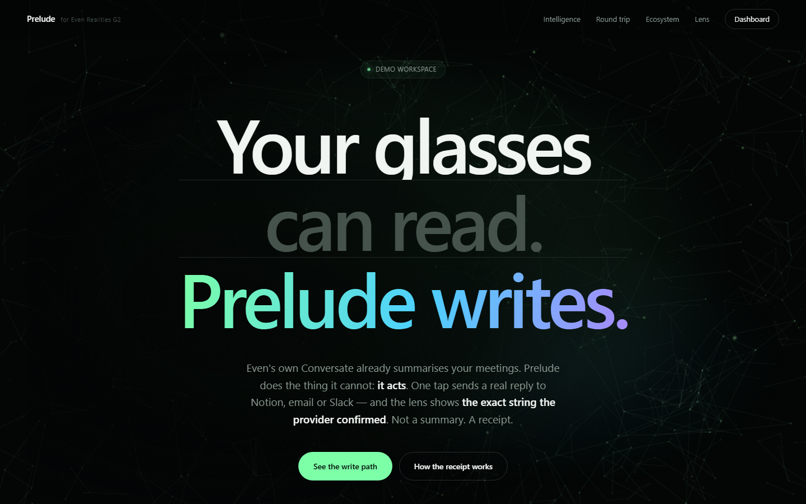
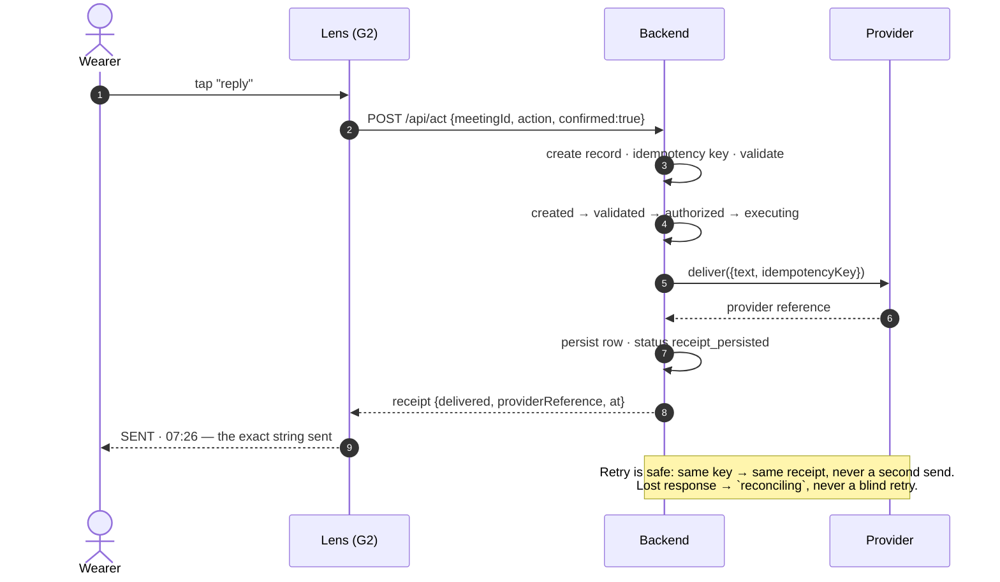
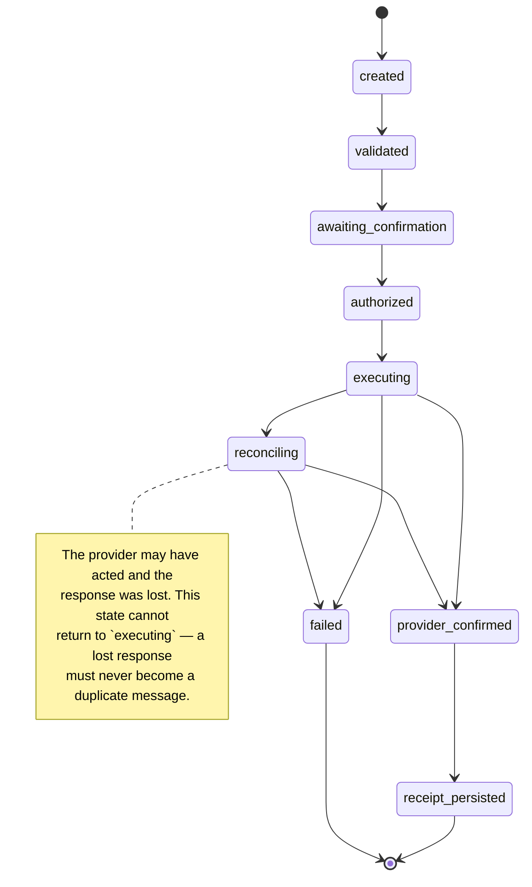
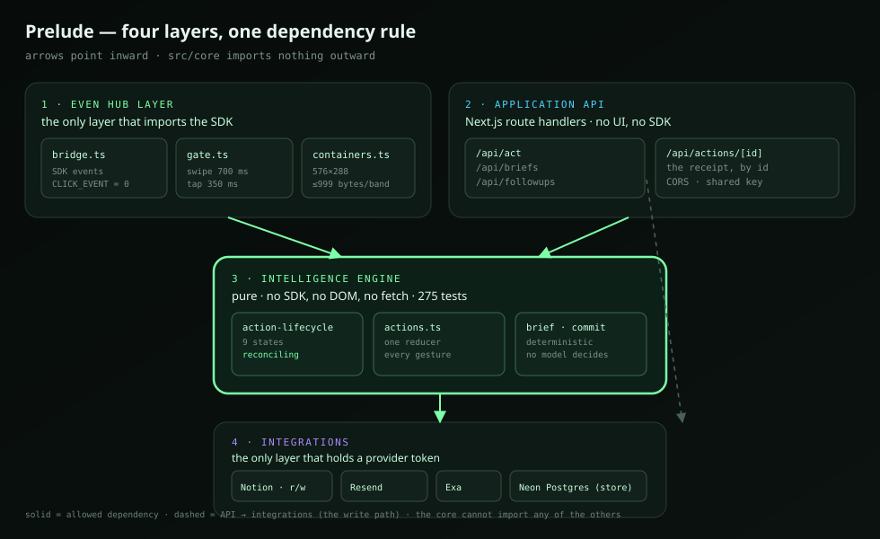
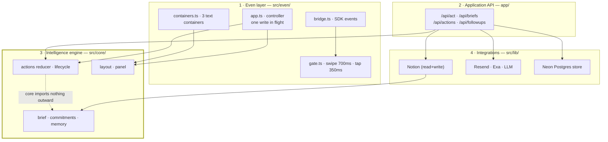

<div align="center">


# Prelude

**The brief before your next meeting — on Even Realities G2.**

You have a meeting in nine minutes, and you know there is something you were supposed to send.
Prelude puts the whole thing on the lens: who you are meeting, what they last said, the doc, and
**the commitment you owe** — then lets you act with one tap, on a display you do not unlock.

[Live backend](https://prelude-green.vercel.app) ·
[Lens mirror](https://prelude-green.vercel.app/lens) ·
[The argument](prelude/STORY.md) ·
[Submission pack](prelude/SUBMISSION.md) ·
[Competitive position](prelude/COMPETITION.md) ·
[Status](prelude/CHECKLIST.md)


`Heads Up · Even Realities × TVM Ventures × Daos Hub` · **Track 04 — AI Assistants & Work**

</div>



## The card

One glance, three text bands on a 576×288 monochrome display — the real `render(state)` output, not a mockup:

```text
┌──────────────────────────────────────────────────────────────┐
│ PRELUDE · 9m                                                 │
│ Ada Lovelace · CTO — Pricing v3 final call                   │
│ OPEN: revised enterprise pricing by Wed · doc Pricing v3     │
│ tap act · swipe next · double exit                           │
└──────────────────────────────────────────────────────────────┘
```

Tap → actions. Swipe → next meeting. Double-tap → exit. The commitment line is the point: every
other app in this field summarises what was **said**; this one leads with what you **owe**.

## Think → act → prove

The write is real, and it is accounted for:



Everything a judge can check afterwards: [prelude/actions](https://prelude-green.vercel.app/actions) —
a row per action, holding the delivered string and the provider's own reference.

### The state machine (9 states, illegal transitions refused)



## Architecture — four layers, one dependency rule



<sub>**Fig. 1** — The arrow that matters: `src/core/` imports nothing from the other three layers. That is why the
pure core is testable in seconds without an SDK, browser or network — and why the safety rules cannot drift with a
model change. Solid edges are allowed dependencies; the dashed edge is the API reaching integrations, which is the
only path a write can take.</sub>



## Verified, not asserted

```text
$ npm run gate
PASS  typecheck           18.7 s
PASS  test                275 passed (20 files)
PASS  manifest            com.prelude.brief v0.1.1 — 2 permissions
PASS  build (plugin)      dist/  ·  static export
PASS  build (app)         .next/ ·  deployable
GATE PASS

$ curl -s https://prelude-green.vercel.app/api/health
{"ok":true,"mode":"demo","auth":"open","version":"0.1.0"}

$ curl -s -X POST .../api/act -d '{... "text":"production retry proof" ...}'
{"ok":true,"actionId":"act_mwyq8059pzbv53","status":"receipt_persisted",
 "delivered":"production retry proof","channel":"demo","at":"2026-11-27T08:35:38.512Z",
 "providerReference":"demo_idem_d7618be0"}

$ # same request again — byte-identical, no second send
{"ok":true,"actionId":"act_mwyq8059pzbv53","status":"receipt_persisted",
 "delivered":"production retry proof","channel":"demo","at":"2026-11-27T08:35:38.512Z",
 "providerReference":"demo_idem_d7618be0"}
```

The packaged `.ehpk` is verified the same way — loaded over `file://`, the way the Even app loads
it, and checked for requests, console errors and a live API round trip
([`prelude/scripts/plugin-e2e.mjs`](prelude/scripts/plugin-e2e.mjs)).

## Where things live

| Path | What it is |
|---|---|
| **[prelude/](prelude/)** | the application — Next.js backend, Even Hub plugin, pure domain core, 275 tests |
| [prelude/STORY.md](prelude/STORY.md) | value, uniqueness, and **15 challenges with how each was beaten** |
| [prelude/SUBMISSION.md](prelude/SUBMISSION.md) | submission copy, track compliance, five API feature requests |
| [prelude/COMPETITION.md](prelude/COMPETITION.md) | what the other 120 builds do, what is crowded, what is rare |
| [prelude/README.md](prelude/README.md) | setup, module boundaries, verified behaviour |
| [notes/](notes/) | working notes from build week — research, event rules, planning |

## Quickstart

```bash
git clone https://github.com/gopanihitansh5-collab/prelude.git
cd prelude/prelude
npm install
npm run dev            # http://localhost:5173 — dashboard, API, lens mirror
npm test               # 275 tests, no SDK, no browser, no network
npm run gate           # typecheck → tests → manifest → plugin build → app build
```

No secrets required. With none set, the app runs in `demo` mode with fixtures and says so in the
header — the demo never depends on a credential.

## Honest limits

- **Notion is the only wired read path.** Google Calendar and Gmail are designed, not built. The strongest
  competitor in this track reads three sources; that is a real gap, not a footnote.
- **No undo window.** Cancel-before-send is table stakes here (one competitor ships 3 s undo). Prelude
  mitigates with preset replies and a confirmation state, and handles the *after* case instead
  (`reconciling`).
- **Single-user, `auth: open`.** A shared key exists (`requireActKey`) but is not enforced for the demo.
- **No hardware validation.** The simulator and the browser mirror were used; the 5-minute locked-phone
  test on physical G2 has not been run, and `CHAR_ADVANCE_PX = 8.6` is an estimate, not measured metrics.
- **Commitment detection is heuristic** and its false-positive rate is unmeasured.
- **The mirror is not the glasses.** It paints the same `render(state)` strings, but the BLE write path
  itself is only exercised by the SDK.

## Licence

MIT — see [LICENSE](LICENSE).
